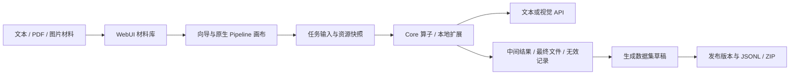

# 架构与组件边界

`Finetune-DataFlow` 管理集成入口、脚本、扩展、文档和组件版本。Core 提供算子与执行能力，WebUI 提供交互、任务与数据管理，`paper-dataflow` 提供论文相关扩展。子模块的具体版本由 `locks/components.json` 和 Git gitlink 共同固定。

向导和画布操作同一配置。四类代表流程使用 Core 执行路径，图片通过 API 接入视觉语言模型。旧 `mm-image-vqa-v1` 配置模板属于独立 MM 路线，其运行桥接限制依然有效；不应把该限制理解为当前四类 API 图片流程不能运行。

`repos/dataflow-mm` 是可选上游参考。它和 Core 都导出顶层 `dataflow` 包，必须使用独立虚拟环境和进程，以 JSON 等协议交换数据；默认安装不安装 MM，也不下载 GPU 模型。

## 数据与文件

| 位置 | 职责 |
| --- | --- |
| `repos/dataflow-webui/backend/data/` | 本地服务、配置、任务注册表、Prompt、Schema 和材料 |
| `backend/data/datasets.sqlite3` | 数据集、样本、材料关联与发布元数据 |
| `backend/data/library/` | 受管原文件、固定输入、媒体与发布文件 |
| `backend/cache_local/` | 步骤缓存、模型原始响应与任务产物 |
| 用户选定的结果目录 | 各次运行最终文件、清单和错误记录 |
| `.venvs/`、`models/`、`logs/`、`output/`、`outputs/` | 本机环境、资源与实验产物，不发布 |

表中的 `backend/` 相对于 WebUI 子模块。路径以组件实际配置为准。

任务产物与数据集发布版本独立保存。生成有效结果可自动收录，后续编辑草稿不回写原始运行文件；发布形成固定样本和媒体版本。备份需要数据库一致性镜像及相关文件，不能只复制 SQLite 主文件或只依靠 Git。

## 验证边界

本地回归验证代码和数据契约。模拟模型响应与历史离线重放不验证远端 API；真实服务运行也不自动证明样本质量、训练收益、吞吐或长期稳定性。项目当前不包含模型训练、RAG、多租户、账户系统和外部遥测。
