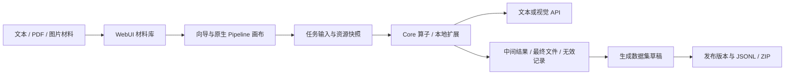

# 架构与组件边界

`Finetune-DataFlow` 管理集成入口、脚本、扩展、文档和组件版本。Core 提供算子与执行能力，WebUI 提供交互、任务与数据管理，`paper-dataflow` 提供论文相关扩展。Core、WebUI、DataFlex 是总仓库中的普通源码目录，导入来源由 `locks/components.json` 和组件的 `UPSTREAM.json` 记录，后续修改由总仓库 Git 管理。只有可选 MM 使用 Git gitlink 固定子模块版本。

向导和画布操作同一配置。四类代表流程使用 Core 执行路径，图片通过 API 接入视觉语言模型。旧 `mm-image-vqa-v1` 配置模板属于独立 MM 路线，其运行桥接限制依然有效；不应把该限制理解为当前四类 API 图片流程不能运行。

`repos/dataflow-mm` 是可选上游参考。它和 Core 都导出顶层 `dataflow` 包，必须使用独立虚拟环境和进程，以 JSON 等协议交换数据；默认安装不安装 MM，也不下载 GPU 模型。

## 数据与文件

| 位置 | 职责 |
| --- | --- |
| `repos/dataflow-webui/backend/data/` | 本地服务、配置、任务注册表、Prompt、Schema 和材料 |
| `backend/data/datasets.sqlite3` | 数据集、样本、材料关联与发布元数据 |
| `backend/data/library/` | 受管原文件、固定输入、媒体与发布文件 |
| `backend/cache_local/` | 步骤缓存、模型原始响应与任务产物 |
| 用户选定的结果目录 | 各次运行最终文件、清单和错误记录 |
| `.venvs/`、`models/`、`logs/`、`output/`、`outputs/` | 本机环境、资源与实验产物，不发布 |

表中的 `backend/` 相对于 `repos/dataflow-webui/`。路径以组件实际配置为准。Mac/学校目录职责、命名和迁移约束见 [目录约定](workspace-layout.md)；学校平台活跃状态位于 node01 本地 Docker 卷，与 NFS 部署目录分开。

任务产物与数据集发布版本独立保存。生成有效结果可自动收录，后续编辑草稿不回写原始运行文件；发布形成固定样本和媒体版本。备份需要数据库一致性镜像及相关文件，不能只复制 SQLite 主文件或只依靠 Git。

## 验证边界

本地回归验证代码和数据契约。模拟模型响应与历史离线重放不验证远端 API；真实服务运行也不自动证明样本质量、训练收益、吞吐或长期稳定性。团队模式增加本地账号、项目隔离和人工数据评测；训练集成沿用独立 DataFlex 边界。学校的直接 GPU 训练、保存重载和评测另有 [实际运行记录](training/dataflex-gpu1-unified-core8-results-20261024.md)，平台 SSH 执行器仍未完成端到端实机验收。不提供产品 Agent、MCP 或外部遥测。

## 局域网团队边界

浏览器通过同源认证网关 `app.team_gateway` 访问。网关验证服务端会话、CSRF、项目成员和操作权限，再转发到对应项目的私有 Unix socket 工作进程。全局单用户容器不在项目间切换；每个项目独立持有原有注册表、SQLite、媒体与执行目录。开发权限属于受信任代码执行权限，不声称操作系统沙箱。

158 条既有及新增业务路由使用显式清单 `backend/app/team_routes.json` 审查。新增端点后需运行 `backend/scripts/audit_team_routes.py` 并核对权限策略；未进入清单的业务路径默认拒绝。Agent 聊天、Agent 子进程和 MCP 运行代码已移除。

账号/会话/成员/个人偏好/审计保存在 `backend/data/collaboration/team.sqlite3`；新项目位于其下的 `projects/<id>`。历史默认项目直接使用原 backend 目录，保持所有业务 ID 与文件引用。样本修订、人工评测、导出记录与既有数据集共用项目的 datasets.sqlite3 事务，发布包及导出文件各自独立。

部署与安全初始化见 [局域网团队使用](lan-usage.md)，实际验证与未验证边界见 [实施记录](lan-implementation.md)。
