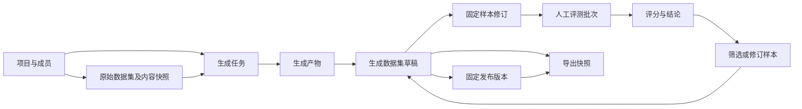

# 局域网团队协作、数据评测与导出 Spec

日期：2026-10-21

版本：v1.0

状态：依据用户已确定的需求整理，待实施；本文不声明功能已交付。

范围：Finetune-DataFlow 集成文档与 DataFlow-WebUI 产品能力。

## 1. 目标与已确定的决定

面向人数较少、规模尚未确定的团队，在一台局域网主机部署共享服务。成员通过浏览器登录，按项目完成以下流程：

> 导入原始数据 → 配置并执行生成流程 → 收集生成样本 → 人工质检 → 发布固定版本 → 导出训练数据。

用户已明确接受：

1. 原始数据集展示生成情况，并可追溯到关联任务、生成数据集和发布版本。
2. 多用户采用共享部署、账号登录和项目隔离；以管理、开发、评测权限组合控制操作。
3. 人工评测对象是生成的数据；每条样本由一人评测，首期不做多人复核。
4. 生成数据集支持草稿和发布版本导出、评测筛选、多种训练格式及图文打包。
5. 只做局域网访问，不提供公网访问、公开注册或公网分享链接。

下文的状态、接口意图和验收规则是上述决定的具体化。具体数据库表名、认证库和组件选型留给实施设计，不将未经验证的依赖写成既定方案。

## 2. 当前基础与本阶段边界

### 2.1 当前实现可复用的能力

| 当前基础 | 本阶段要补齐的部分 |
| --- | --- |
| 原始材料、输入数据集、生成任务、草稿及固定发布版本 | 原始数据到生成结果的可靠关联、聚合显示与历史兼容 |
| 样本来源记录包含 task、artifact、pipeline、产物哈希及行号 | 明确输入内容身份、跨任务来源、样本修订与评测关联 |
| 草稿基本编辑，部分资源已有冲突检查 | 多人并发下统一的版本检查、归属与权限 |
| 发布版本可下载数据和媒体包、基础 JSONL，以及兼容时的 Alpaca 格式 | 列表/详情统一导出、草稿快照、评测筛选、对话和 DPO 映射 |
| 训练运行及模型产物评测记录 | 独立的生成样本人工评测，不复用为同一种评测对象 |
| SQLite 元数据与受管文件存储 | 账号、项目、权限、评测记录及可核验的迁移 |

当前 WebUI 的项目规则仍以本地单用户为前提。本 Spec 记录用户授权的新目标；实施多用户阶段时须同步更新 WebUI 的 `CLAUDE.md` 及相关架构、启动和使用文档。仅增加本文不会使当前服务成为可安全共享的多用户服务，也不在本次文档任务中修改运行配置。

### 2.2 首期不包含

- 公网部署、组织层级、多租户商业管理、计费、配额和公开注册。
- 企业 SSO、第三方账号登录、邮件邀请或邮件找回密码；邀请由管理员手动交付。
- 同一样本的多人独立评分、交叉复核、仲裁、模型盲评或模型 A/B 比较。
- 自动按平均分判定通过、自动修改问答、自动发布或自动触发训练。
- 新增 DPO 生成算法或重写现有 Core 算子注册、执行契约。
- 将本阶段的离线功能验收表述为真实模型 API、SSH 或 GPU 训练验收。

## 3. 术语与对象关系

术语以根目录 [CONTEXT.md](../CONTEXT.md) 为准。人工样本质检在界面中称“人工评测”；与现有模型产物的“评测记录”区分。

关系约束：

- 所有业务资源归属一个项目；关联资源必须在同一项目内。
- 原始数据集与生成数据集是多对多关系，经过任务、产物和样本来源建立联系。
- 原始数据集内容身份与其名称、目录路径分开；改名不代表内容变化，同一路径的内容变化必须能识别。
- 样本有稳定 ID 和内容修订；相同内容可以保留多个来源。去重不能丢失来源关系。
- 评测结论绑定样本修订及批次，不绑定草稿中的可变行号。
- 发布版本与导出快照各自固定内容；导出草稿不自动发布。

## 4. 原始数据集的生成情况

### 4.1 列表与详情

原始数据集列表增加“生成情况”列，保留现有名称、类型、数量及更新时间。采用紧凑列表，点击查看关联详情，不引入强制向导。

| 信息 | 判定口径 | 点击行为 |
| --- | --- | --- |
| 未生成 | 无可关联的成功生成产物 | 查看历史任务或创建生成配置 |
| 生成中 · N 个任务 | 有排队或运行中的关联任务 | 查看这些任务 |
| 有结果待收集 · N 个任务 | 已有可收集产物，且未完成收集 | 查看任务及待收集产物 |
| 已生成 · N 个数据集 | 该来源的样本已被收集，按生成数据集 ID 去重 | 查看关联生成数据集 |
| 已发布 · N 个版本 | 存在确实包含该来源样本的发布版本 | 查看固定发布版本 |

以上信息可以共存。例如“已生成 2 个数据集 · 生成中 1 个任务”。失败、取消和重复运行不会抹掉既有成果；只有失败记录且无成功产物时展示“未生成”，附最近失败提示。

关联详情展示任务、Pipeline 身份/快照、输入内容身份、生成时间、任务状态、产物、目标数据集、来源样本数、评测进度和发布版本。集合总样本数与来自本来源的样本数分别标明，不能混用。

列表支持筛选：有无生成成果、有无活动任务、有无待收集结果、有无发布版本、来源是否待确认。聚合与分页在后端完成，避免每一行逐个请求任务和草稿。

### 4.2 来源和更新规则

- 生成任务固定实际输入成员及内容哈希；不能只保存可变化的目录路径。
- 只处理部分输入时展示“已处理部分输入”。无法计算覆盖率时显示未知，不用产物条数冒充输入覆盖率。
- 输入覆盖数仅在执行器提供可靠成员级证据时统计，并以任务固定输入为分母；一条原始记录生成多条样本不增加覆盖数。
- 原始内容更新后，旧结果仍可查看，同时提示“已有结果基于旧内容”；旧结果不计入新内容的覆盖率。
- 多来源合并、收集合并去重后，分别保留所有可验证的来源。
- 生成成功但零有效样本时标明“已完成，无有效样本”，不计为已生成训练数据。
- 数据集归档后关联保留并显示归档标识；不因归档变回“从未生成”。
- 历史来源仅按明确任务输入、产物和样本证据补齐，记录补齐依据；证据不足显示“来源待确认”。
- “已生成”不表示已经人工通过、已经发布或已经完成模型训练。

## 5. 局域网账号、项目与权限

### 5.1 部署和账号

- 一台局域网主机运行一个共享 WebUI 服务，成员使用各自电脑的浏览器访问；服务端口和监听地址显式配置，不配置公网映射。
- 前后端同源访问。实际共享部署需提供内网 HTTPS 的配置与使用说明；不能把局域网等同于凭据传输保护。
- 首次部署在主机上初始化管理员；不向未认证的局域网访问者暴露“抢先成为管理员”的入口，不内置通用默认密码。
- 管理员可创建账号或生成一次性、限时邀请；邀请链接手动交付。受邀者设置自己的密码，首期不依赖邮件。
- 支持登录、退出、修改自己的密码、管理员禁用账号及发起密码重置。管理员不能读取原密码。
- 禁用账号、退出、密码重置后使相应会话失效；禁止禁用或移除最后一个可用系统管理员。
- 服务器重启后账号、成员、归属和评测记录保留。人数不设人为业务上限；首期以小团队使用验证，不声称高并发能力。

### 5.2 管理范围与权限表

区分系统管理员与项目管理权限：系统管理员管理账号、建项目及迁移；项目管理者管理本项目成员和资源，不因此成为其他项目管理员。系统管理员的跨项目管理操作显式可见并记录审计。

| 操作 | 项目管理 | 项目开发 | 项目评测 |
| --- | --- | --- | --- |
| 管理本项目成员与权限 | 是 | 否 | 否 |
| 浏览本项目业务资源 | 是 | 是 | 仅分配批次及完成评测所需上下文 |
| 导入材料、管理 Pipeline/Prompt/Schema | 是 | 是 | 否 |
| 执行生成、收集结果、编辑普通草稿 | 是 | 是 | 否 |
| 新建、分配、关闭评测批次 | 是 | 是 | 否 |
| 领取评测、提交评分与修改建议 | 同时授予评测权限时 | 同时授予评测权限时 | 是 |
| 修改并通过被分配样本 | 同时授予评测权限时 | 同时授予评测权限时 | 是，限当前领取的评测项 |
| 发布版本、导出数据/评测明细 | 是 | 是 | 否 |
| 配置共享服务和凭据 | 是 | 否 | 否 |
| 使用共享模型服务 | 按项目授权 | 按项目授权 | 不因评测权限自动获得 |

项目权限可组合。界面按权限显示操作，后端独立验证权限；伪造项目 ID、直接请求资源 ID 或下载 URL 都不能绕过隔离。

### 5.3 资源与运行边界

- 材料、文件、Pipeline、资源引用、任务、草稿、评测、发布版本、导出及训练记录均需项目归属。
- Prompt、Schema 和服务按项目使用；首期不做任意跨项目引用。内置无凭据模板可以作为系统只读资源使用。
- 模型服务密钥在读取、列表、导出、错误信息和日志中脱敏；使用授权不等于查看密钥授权。凭据不进入前端持久化存储。
- 评测页面只读取必要上下文，不能借来源链接获取整个其他项目或无关任务日志。
- 对普通局域网用户关闭主机原生文件选择器、任意服务器路径导入/下载和任意命令入口；用户电脑文件通过上传处理。确需服务器目录导入时，限管理员配置的允许目录。
- 原有 Agent、WebSocket、MCP、静态文件、任务日志及下载入口纳入认证与授权审计，不能遗留匿名旁路。
- 开发权限属于受信任的执行权限。首期不承诺任意 Python/Pipeline 代码的操作系统级沙箱；普通评测者不能创建或运行代码。
- 密码仅保存安全摘要；会话使用 HttpOnly Cookie、合适的 SameSite/HTTPS 配置，写操作校验 CSRF/来源；限制登录尝试，不在 URL 中传密码或会话凭据。

### 5.4 并发与审计

- 对草稿、Pipeline、Prompt、Schema、训练方案和权限等可编辑对象提供版本标识；保存时校验预期版本。
- 冲突提示“内容已更新”，允许刷新和保留自己的待提交内容；不静默覆盖、不自动拼接不兼容编辑。
- 至少记录创建者、最近修改者，以及成员/权限、服务配置、执行、收集、评测、发布、导出和删除等关键动作的操作者、时间、对象、结果及修订身份。
- 审计不保存明文密码、密钥、会话值或无必要的完整样本正文。禁用账号不会删除历史操作者身份。

## 6. 人工数据评测

### 6.1 入口与批次创建

生成数据集详情增加“人工评测”入口；主导航增加统一“人工评测”页面。开发成员查看项目进度，评测成员默认看到自己的待办及可领取范围。

创建批次时固定：数据集及草稿快照/发布版本、样本 ID 与修订、必要来源和媒体、评分模板、抽样方式、样本数、创建者及允许评测人员。

- 支持全量或随机抽样。随机抽样无放回，保存随机种子和最终成员清单。
- 显示可选样本总量与实际选中数量；抽样数量大于可选总量时明确提示，不静默重复采样。
- 空数据集不能创建批次；有来源缺失的样本允许评测，但必须显示缺失提示并允许“无法判断”。
- 同一批次内每个固定样本修订只有一个正式评测项；重复提交创建请求不能重复生成批次。
- 后续向草稿添加样本不会扩充已有批次，移除或修改样本不会改写已有评测对象。

### 6.2 评测页面与默认模板

页面提供原始材料/上下文与生成内容对照。文本 SFT 展示指令和回答，对话展示消息顺序，DPO 展示 chosen/rejected，图文展示实际图片及文字。支持上一条、下一条、跳过和稍后继续；离开有未保存内容时提示。

| 字段 | 默认规则 |
| --- | --- |
| 正确性 | 整数 1～5 分，1 表示明显错误，3 表示存在需修正问题，5 表示未发现错误 |
| 来源支持 | 整数 1～5 分，1 表示无依据或矛盾，3 表示部分缺少支持，5 表示有充分依据 |
| 表达与可用性 | 整数 1～5 分，1 表示不可用，3 表示需要修改，5 表示清楚且适合目标格式 |
| 最终结论 | 通过／需修改／拒绝，由评测者显式选择 |
| 问题标签 | 可多选：事实错误、缺少依据、答非所问、格式错误、重复、图片不匹配、其他 |
| 评语 | 通过时选填；需修改、拒绝时必填；选择“其他”需说明 |

创建者可调整维度、说明和问题标签，随批次冻结。某维度无法判断时需标明原因，不强迫给分；有无法判断的必评维度时不能直接通过，可保存为需修改或拒绝。不可适用维度应在建批次时调整模板。

提交普通最终结论时要求所有必评维度有分数或明确的无法判断原因。系统不按平均分自动改变结论，不在提交评测时调用模型。

### 6.3 分配、领取与状态

- 批次可指派成员，也可允许指定成员从待办池领取。评测成员看不到未授权批次。
- 批次状态：草稿 → 进行中 → 已完成；也可由管理/开发成员中止为已关闭。已关闭保留已有结果，未完成项不算已评。
- 样本项状态：待领取 → 已领取 → 已提交。跳过是保留待处理标记，不计完成；“稍后继续”保留本人草稿和领取归属。
- 领取必须原子化。两人同时领取时只能有一人成功，另一人刷新待办；服务器校验领取人与预期版本。
- 已领取任务由本人释放，或由管理/开发成员重新分配；重新分配使旧领取权限失效并记录原因，不静默丢弃已保存评测草稿。
- 提交操作具备幂等性，重复点击不产生多份正式结论。提交成功后可进入下一条。
- 首期每个样本项只需一人完成，不做复核。管理/开发成员可显式重开错误提交并保留历史；不是追加第二评测者仲裁。

### 6.4 修改并通过与内容变化

“修改并通过”是评测者在当前领取项中的受限操作，不等于可任意编辑整个数据集：

1. 保留原始修订及原评测输入，填写修改后的内容和修改原因。
2. 对修改后内容校验数据类型、必需字段和媒体引用。
3. 修改后内容形成新样本修订；评分与通过结论明确绑定新修订，保留旧修订到新修订的修订关系。
4. 源于草稿且目标样本仍为预期修订时，原子更新草稿与评测记录；发生并发修改则整笔失败并提示比较，不部分保存。
5. 源于发布版本时，不能覆盖已发布内容；修订先保留为评测结果，由开发成员应用到派生草稿，再发布新版本。

普通草稿编辑也产生新修订，不继承旧修订的通过标记。批次继续显示它评过的固定内容，数据集详情提示“当前修订尚未评测”。来源和旧评语不被覆盖。

### 6.5 汇总与评测结果使用

- 展示总数、已提交、待处理、通过、需修改、拒绝、跳过标记、无法判断数量，以及维度分布和问题标签分布。
- 完成率 = 已提交项数 / 批次项数；通过率 = 通过项数 / 已提交项数。分母为零显示“暂无”，不显示误导性百分比。
- 抽样批次的结论只覆盖抽中样本，不能显示为整个数据集已全部通过。
- 过滤“评测通过”时必须明确选择评测批次，只选择该批次通过的确切样本修订；不能将未抽样、需修改或拒绝样本混入。
- 同一修订可以出现在不同批次中；不合并为一个含糊的全局分数，展示批次及时间，导出时选择适用批次。
- 支持将通过样本整理为派生草稿，并保留来源、修订和评测引用；不自动删除原草稿中的拒绝样本。
- 发布固定实际包含的样本、媒体及所采用评测结论的引用。发布是显式操作，不要求所有普通发布必须经过人工评测。

## 7. 生成数据集导出

### 7.1 入口与选择

生成数据集列表的行操作和详情工具栏提供“导出”。导出面板包含来源（当前草稿或指定发布版本）、样本范围、评测批次、格式、字段映射及媒体方式。正式训练默认推荐已发布版本，但不阻止草稿导出。

- 范围支持全部样本、指定批次评测通过样本；评测明细可单独导出。
- 当前草稿导出固定请求时的样本修订及成员，导出期间的编辑不影响文件。
- 从发布版本导出只包含该版本已有内容，评测筛选只能缩小范围，不能引入版本外的修订。
- 当前草稿不再包含评测通过的旧修订时，显示冲突数量并要求显式选择整理派生草稿或更换范围，不能静默导出旧内容/新内容。
- 筛选结果为空时提示，不生成看似成功的空训练包。
- 确认导出不自动发布，不启动训练、不下载模型，也不调用外部 API。

### 7.2 格式与转换

| 格式 | 适用范围与契约 |
| --- | --- |
| 原始 JSONL | 保留选中样本的原有业务字段，UTF-8，每行一个有效 JSON 对象 |
| Alpaca | instruction/input/output；可明确映射缺省为空的 input，不允许缺失必要指令或回答 |
| 对话 JSONL | messages 数组，消息顺序与角色明确；system 内容仅来自已有数据或显式映射 |
| DPO JSONL | 按输入结构保留 prompt/chosen/rejected 或明确的对话偏好映射；不从单一回答臆造 rejected |
| 数据与媒体 ZIP | 训练数据、引用到的媒体、manifest；文件使用包内相对路径 |
| 评测 CSV / JSONL | 批次、样本/修订、评分、结论、标签、评语、评测者、时间和修订关系 |

转换前展示兼容样本数及错误。混合或不兼容记录默认阻止导出，提供样本位置/ID和修复提示；首期不提供静默跳过坏行。输出列映射及被排除列在确认前可见。训练格式通常仅保留训练字段，评测/来源作为独立清单；原始 JSONL 明确保留业务字段。

图文导出默认推荐 ZIP。若选择仅 JSONL，必须说明媒体未包含并检查引用策略；训练格式的可移植包不能保留主机绝对路径。ZIP 缺失任一必需媒体时整体失败，不返回半成品为成功。

### 7.3 一致性、文件与下载

导出记录至少包含 export_id、project_id、来源与修订/发布版本、批次与筛选条件、格式映射、样本数、媒体清单、内容哈希、创建者、创建时间和状态。manifest 不携带服务凭据、服务器绝对路径或无必要的原始材料正文。

- 导出状态：准备中 → 可下载／失败；取消与过期要清楚显示。关闭页面后可再次进入查看。
- 文件完成并核验记录数、可解析性和媒体引用后才标记可下载；写入失败不留下可下载的残缺文件。
- 下载进行权限检查，不能凭 export_id 跨项目下载；账号禁用或项目权限撤销后，旧链接不继续授权。
- CSV 的用户自由文本需防止被表格软件当公式执行。ZIP 路径校验防止越出包内目录。
- 相同请求重复提交不重复生成逻辑记录；同一内容、格式和映射应产生语义一致的数据，ZIP 时间戳不作为内容一致性的依据。
- 发布版本的内容不会随临时导出文件清理而丢失。只清理可再生成的导出缓存，清理策略显式配置，不能清掉原始材料和发布版本。

## 8. 页面与交互清单

| 页面 | 首期变化 |
| --- | --- |
| 登录 / 接受邀请 / 修改密码 | 建立局域网账号入口，不开放公开注册 |
| 项目选择与成员管理 | 切换项目、查看可用权限、按权限管理成员 |
| 原始数据集列表/详情 | 生成情况、来源内容变化提示、关联成果与任务跳转 |
| 生成数据集列表/详情 | 导出、发起人工评测、批次进度、修订适用性、发布 |
| 人工评测批次列表 | 创建、抽样、分配、领取、进度、关闭和结果筛选 |
| 样本评测工作台 | 来源对照、评分、标签、结论、修改并通过、保存进度 |
| 导出列表/详情 | 查看准备状态、错误、manifest 与再次下载 |
| 管理设置 | 账号、项目、服务凭据、关键操作记录 |

保持现有中文、浅色/深色和原生控件风格；画布与参数详情继续作为直接入口。项目切换时处理未保存编辑，不把旧项目的列表/待办残留成新项目内容。当前全局偏好拆分为个人偏好与项目/系统运行配置，切换语言和主题不影响其他成员。

## 9. 持久化、接口与迁移约束

### 9.1 数据与接口契约

复用现有存储边界，增加以下逻辑对象：账号/会话、项目/成员权限、输入内容快照与来源关联、样本修订、评测批次/成员项/领取/提交历史、导出记录与审计。逻辑对象不要求一对象一张表，但必须支持事务、索引、唯一性及版本检查。

| 接口能力组 | 必须具备的行为 |
| --- | --- |
| 账号与项目 | 获取当前身份/权限，登录退出、邀请/禁用、项目与成员管理 |
| 原始数据关联 | 分页聚合生成情况、查询关联详情与内容身份 |
| 评测批次 | 创建/抽样/指派/关闭、分页进度与结果 |
| 评测样本项 | 原子领取/释放、保存草稿、幂等提交、修订并通过、重开历史 |
| 导出 | 创建固定快照、查询状态、检查兼容性、授权下载 |
| 审计 | 按权限查询对象关键操作，不回传凭据 |

实施时在 WebUI 内确定具体路由、请求/响应 Schema、错误码及索引，并补接口契约测试。所有既有接口一并检查项目隔离；不能只给新页面加权限。未登录、无权访问、不存在、版本冲突和格式不兼容要有可区分的稳定行为，同时避免泄露其他项目对象是否存在。

不因为当前人数较少就假定文件写入不会并发。领取、修订并通过、发布与导出选择固定必须原子化；任务执行不持有长时间的数据库写锁。继续使用 SQLite 时需验证短事务、锁等待和多连接行为；不在本文预定迁移到另一种数据库。

### 9.2 现有数据迁移

1. 实施迁移前重新盘点并创建当时的一致性备份，验证恢复；此前环境同步备份已按用户要求删除，不能假定仍可使用。
2. 显式初始化管理员和默认项目，既有材料、配置、任务、数据集、训练方案及历史归入该项目。
3. 保留已有业务 ID、文件、样本来源、发布版本和内容哈希；不能通过重建示例覆盖旧数据。
4. 无明确创建者的旧记录标记“历史导入”，不伪造个人操作历史。旧来源未知的记录保留未知。
5. 迁移有版本和完成标记，可重入；失败不开放部分授权状态，也不启动生成/训练。
6. 复核记录数、内容哈希、文件可访问性、原有中文配置、Pipeline/服务绑定、草稿/发布版本及训练历史。
7. 历史客户端需要重新登录；既有工作流和资源内容继续可用。未归属的资源不能在缺少项目参数时默认对所有人开放。

### 9.3 仓库职责

- 根仓库：本 Spec、实施/迁移/验收文档、部署入口及组件版本固定。
- WebUI：账号/项目、页面、API、来源聚合、人工评测、导出与持久化适配。
- Core：优先复用已有算子，仅确有缺失能力时另行提出修改，不为账号权限改写算子注册语义。
- 独立 DataFlex 与可选 DataFlow-MM：保持现有仓库及进程边界，不将其迁移为用户/权限存储。

## 10. 验收标准

以下全部通过后才能声明本阶段完成；功能测试使用隔离数据，不能消费真实模型 API 或触发 SSH/GPU 训练。

| 编号 | 场景与通过条件 |
| --- | --- |
| S01 | 同一来源生成两个数据集，同时有新任务运行；列表同时显示成果与活动任务，数量去重准确 |
| S02 | 成功未收集、部分成功、零样本、失败和取消各自准确展示，不覆盖此前成果 |
| S03 | 来源内容变化后提示旧输入，覆盖率分母仍为对应输入快照；历史未知来源不误关联 |
| S04 | 合并去重后保留多来源；发布版本仅统计实际包含该来源样本的版本 |
| U01 | 两个项目的账号无法通过列表、直接 ID、下载、静态路径、日志、WebSocket 或 MCP 跨项目读取/修改 |
| U02 | 评测权限不能创建 Pipeline、调用模型服务、执行代码、任意读取主机路径或发布导出 |
| U03 | 邀请一次性/过期生效；禁用/退出/重置使会话失效；服务密钥不出现在页面、导出和日志 |
| U04 | 两名成员同时编辑同一对象，后保存者收到冲突且先保存内容保留；个人主题/语言互不影响 |
| U05 | 至少三名成员使用两个项目同时浏览、领取和保存，不串数据、不丢写；此用例不是人数上限或吞吐承诺 |
| R01 | 随机抽样可重现、成员无重复；创建后编辑/增删草稿不改变评测快照 |
| R02 | 两人竞争同一评测项只有一人领取成功；释放/重分配使旧持有者提交失败 |
| R03 | 评分/评语校验正确；跳过不计完成；重复提交只产生一份正式结果；刷新后可继续 |
| R04 | 修改并通过保留原文与修订链；并发冲突整笔失败；发布版本原内容不变 |
| R05 | 草稿再次改写后不继承通过；抽样通过不等于全数据通过，汇总分母准确 |
| E01 | 导出期间编辑草稿，输出仍对应创建时固定内容；发布版本导出内容稳定 |
| E02 | 按指定批次筛选只包含通过的准确修订；旧修订冲突、零结果、不兼容字段不静默跳过 |
| E03 | JSONL/Alpaca/对话/DPO 可重新解析，映射准确，不臆造 rejected 或 system 内容 |
| E04 | 图文 ZIP 解压后全部媒体引用可解析，无服务器绝对路径、缺图和凭据；缺失媒体报错 |
| E05 | 评测 CSV/JSONL 与训练内容分离，用户文本不会成为可执行表格公式；旧下载链接不能绕过权限撤销 |
| M01 | 旧数据迁移前后身份、内容、历史及引用保持，默认项目仅授权成员可见，失败/重入可恢复 |
| G01 | 浏览器完成“来源 → 生成结果 → 评测 → 通过样本 → 发布 → 下载并重读”全过程，保存/刷新/重开有效 |

实施回归应运行根仓库 `./scripts/test-local.sh`、相关前端测试及构建，再做真实局域网浏览器验收。用固定响应夹具完成流程测试；如另需真实 API 或 GPU 验收，应单独列明资源与执行边界。

## 11. 建议实施顺序与完成边界

| 阶段 | 交付内容 | 进入下一阶段前的检查 |
| --- | --- | --- |
| P0 | 更新单用户约定、盘点全部入口、确定接口/存储设计与迁移方案 | 路由授权覆盖、默认项目归属、恢复方案可审查 |
| P1 | 账号、项目、权限、会话、审计和现有数据迁移 | U/M 验收通过；所有已有业务入口受保护 |
| P2 | 输入内容身份、来源关联与生成情况 | S 验收通过；历史记录不误标 |
| P3 | 批次、领取、工作台、修订并通过与汇总 | R 验收通过；不改变发布版本 |
| P4 | 统一导出、评测筛选、训练格式及媒体包 | E 验收通过；下载可重读 |
| P5 | 局域网集成、旧功能回归和使用说明 | G 验收、相关回归、部署与权限检查通过 |

本文交付完成指 Spec、术语和入口文档可审查，并不授权自动开始实施、开放监听、创建账号、迁移数据、发布或推送。代码实施应基于本文另行进入开发任务。

## 12. 当前实现与历史设计参考

- [领域术语](../CONTEXT.md)、[架构](architecture.md)、[开发与验证](development.md)。
- [旧版平台范围](finetuning-platform-v1.md)：保留历史设计背景，本阶段多用户和人工评测的新范围以本文为准。
- [原始材料与草稿 API](../repos/dataflow-webui/backend/app/api/v1/endpoints/data_library.py)。
- [生成、收集、发布与下载 API](../repos/dataflow-webui/backend/app/api/v1/endpoints/generation.py)。
- [样本来源、编辑及发布服务](../repos/dataflow-webui/backend/app/services/training_lifecycle.py)。
- [现有 SQLite 数据集存储](../repos/dataflow-webui/backend/app/services/dataset_database.py)。
- [现有数据集整理与下载组件](../repos/dataflow-webui/frontend/src/components/manage/library/DatasetLifecycle.vue)。
- [WebUI 当前单用户约定](../repos/dataflow-webui/CLAUDE.md)：实施 P0 时同步调整，本文未修改该文件。
